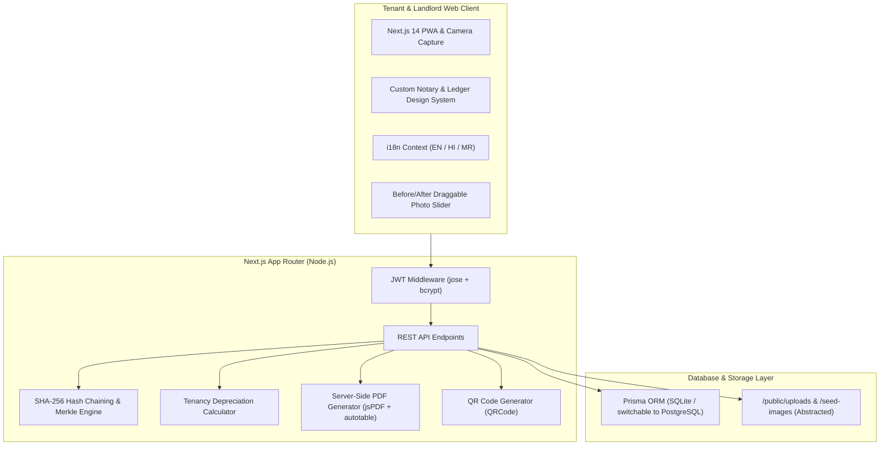
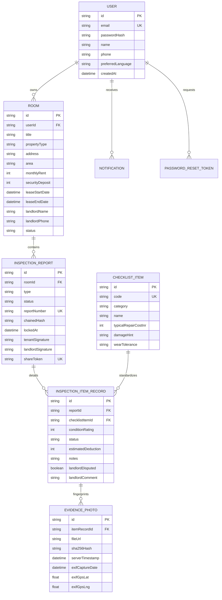

# DepositLocker • Official Tenancy Inspection & Deposit Protection Registry

> **Design Thinking Prototype**: Tamper-Evident Security Deposit Protection for Tenants in Urban India (Pune & PCMC).

[](https://nextjs.org/)
[](https://www.typescriptlang.org/)
[](https://www.prisma.io/)
[](https://tailwindcss.com/)
[](https://en.wikipedia.org/wiki/SHA-2)

---

## 🏛️ Project Overview

**DepositLocker** is a production-quality web application built to eliminate the widespread "security deposit trap" experienced by students and young working professionals in flats and PGs across India. 

Tenants frequently forfeit between ₹10,000 and ₹30,000 to arbitrary deductions (such as full flat repainting for minor scuffs, pre-existing floor cracks, or unitemized cleaning penalties) due to a complete lack of verifiable move-in proof.

DepositLocker addresses this through an **"Official Inspection Record"** conceptual framework:
- **Paper & Notary Aesthetic**: Designed as an official ledger with notary seal stamps, paper grain textures, perforated tear-off edges, and typewriter mono accents.
- **SHA-256 Evidence Chaining**: Every photograph taken at move-in and move-out is fingerprinted with cryptographic SHA-256 and chained into an immutable report root. Any post-handover alteration is mathematically detectable.
- **Automated Depreciation Diff Engine**: Complies with Model Tenancy Act principles—distinguishes normal domestic wear (₹0) from pre-existing flaws (₹0) and calculates fair depreciated deductions instead of arbitrary replacement fines.
- **Frictionless Landlord Engagement**: Zero-login, mobile-ready QR code and tokenized web links allowing property owners to inspect evidence and digitally sign in under 60 seconds.
- **Multilingual Support**: Real-time switchable i18n between English, हिन्दी (Hindi), and मराठी (Marathi).

---

## 🚀 One-Command Quickstart

```bash
npm install && npx prisma migrate dev && npm run seed && npm run dev
```

Visit [http://localhost:3000](http://localhost:3000) in your browser.

### Demo Credentials
- **Email**: `demo@depositlocker.com`
- **Password**: `demo123`
*(A 1-click "Fill Demo Login" button is also present directly on the login screen).*

---

## 📐 System Architecture



---

## 🗄️ Entity Relationship (ER) Diagram



---

## 🌟 Key Features

| Feature | Description |
| :--- | :--- |
| **Guided 40-Point Inspection** | Walkthrough across 9 categories (Walls, Flooring, Ceiling, Doors/Windows, Furniture, Electrical, Bathroom, Kitchen, Safety) with segmented 1–5 scoring and live camera capture. |
| **Cryptographic SHA-256 Chaining** | Immediate hashing of photos upon capture; report locking computes an immutable digest chain preventing post-hoc fabrication. |
| **Live Tamper Verification** | `/reports/[id]/verify` recomputes cryptographic roots in real time and flags any discrepancy as *Intact* or *Tampered*. |
| **Depreciation Diff Engine** | Drop of 1 = Normal Wear & Tear (₹0), Move-in rating ≤ 2 = Pre-existing (₹0). Drops ≥ 2 apply useful life depreciation (Model Tenancy Act). |
| **Interactive Before/After Slider** | Draggable split slider allowing side-by-side visual comparison between Move-In and Move-Out photos for disputed items. |
| **Zero-Login Landlord Flow** | Landlords access reports via unique shareable link or QR code, inspect photos, comment on items, and provide digital signature. |
| **Legal Dispute Helper** | Generates tailored, factual notices citing certificate numbers and SHA-256 hashes, with 1-click WhatsApp and email sharing. |
| **Official PDF Generation** | Server-side printable inspection certificates with notary ledger styling, QR codes, and digital signatures. |
| **Deposit Analytics & Insights** | Interactive Recharts visualizations of 30 survey respondents across Pune hubs (Akurdi, Wakad, Hinjewadi, Nigdi, Chinchwad, Kothrud). |
| **Design Thinking Section** | Dedicated `/about` route documenting Empathize, Define, Ideate, Prototype, and Test phases. |

---

## 🔌 API Endpoints Summary

| Method | Endpoint | Description |
| :--- | :--- | :--- |
| `POST` | `/api/auth/login` | Authenticates tenant & sets httpOnly cookie |
| `POST` | `/api/auth/register` | Registers tenant with language preference |
| `POST` | `/api/auth/logout` | Clears authentication session cookie |
| `GET` | `/api/auth/me` | Retrieves current session user |
| `POST` | `/api/auth/forgot-password` | Generates password reset token |
| `POST` | `/api/auth/reset-password` | Resets password using token |
| `GET` | `/api/rooms` | Fetches tenant rooms with report statuses |
| `POST` | `/api/rooms` | Registers new property and creates draft move-in report |
| `GET` | `/api/rooms/[id]` | Fetches room ledger hub and 40 checklist items |
| `PUT` | `/api/rooms/[id]` | Updates room particulars |
| `DELETE`| `/api/rooms/[id]` | Archives room record |
| `GET` | `/api/reports/[id]` | Fetches report, items, photos, and chained hashes |
| `POST` | `/api/reports/[id]` | Auto-saves item ratings, notes, and photos |
| `POST` | `/api/reports/[id]/lock` | Permanently seals report with SHA-256 chain |
| `GET` | `/api/reports/[id]/verify` | Recomputes SHA-256 chain and verifies tamper status |
| `GET` | `/api/reports/[id]/pdf` | Streams downloadable official PDF certificate |
| `GET` | `/api/landlord/[token]` | Public read-only landlord inspection view |
| `POST` | `/api/landlord/[token]` | Landlord digital acknowledgment or item dispute |
| `POST` | `/api/upload` | Multipart file upload with SHA-256 calculation |
| `GET` | `/api/notifications` | Fetches in-app notifications |
| `PATCH`| `/api/notifications` | Marks all notifications as read |

---

## 🎨 Design System Specifications

- **Paper Background**: `#F4EFE6` (Paper Cream)
- **Ink Primary**: `#1B1A17` (Deep Carbon Ink)
- **Verified Accent**: `#2F5D50` (Forest Green)
- **Warning / Alert**: `#C8412B` (Vermilion)
- **Caution / Fair**: `#C27803` (Mustard Amber)
- **Dark Mode**: Charcoal (`#161513`) and Cream (`#EDE7DC`)
- **Headings Font**: Fraunces (Variable Serif)
- **Body Font**: IBM Plex Sans
- **Codes & Hashes Font**: IBM Plex Mono
- **Icons**: Custom pure SVG line icons (zero emoji, zero icon webfonts)

---

## 📄 License
MIT License. Created as a Design Thinking Prototype for Tenant Protection in India.
